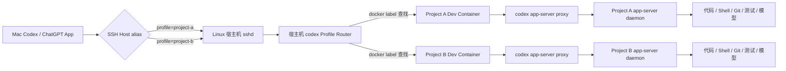

# 让 Codex 直接运行在远端 Dev Container：从 Mac 到 iPhone 的透明开发方案


## 背景：环境在远端，Codex 在本地

很多团队的真实开发环境并不在工程师的笔记本上，而是在一台长期运行的 Linux 开发机中：代码、依赖、数据库、编译工具链和测试服务都封装在 Dev Container 里，本地 Mac 只负责编辑和交互。

这种模式解决了环境一致性问题，却给 Coding Agent 带来一个新的矛盾：

- 在 Mac 上运行 Codex，文件系统和 Shell 不在真正的开发环境里；
- 通过 MCP 逐个封装文件、搜索和 Shell 操作，复杂任务会产生大量跨机器往返；
- 在容器里运行 Codex CLI，执行效率高，但 Mac 和 iPhone 上缺少统一、友好的任务界面；
- 给每个容器安装 SSH Server 又会引入端口、密钥、生命周期和安全维护成本。

本文给出一种经过实际验证的方案：**Codex App 仍然使用官方 Remote SSH 机制，但远端宿主机上的 `codex` 命令被替换为一个很薄的 Profile Router。Router 根据 SSH alias 传入的 profile，使用 `docker exec` 把 Codex App Server 原样启动到正确的 Dev Container 内。**

最终效果是：

- Mac Codex App 中，每个 Dev Container 表现为一个独立的 SSH 远端环境；
- Codex 直接读取容器内文件、执行容器内 Shell、使用容器内依赖；
- Git、测试、构建和长任务都发生在远端容器内；
- iPhone 只是控制端，任务仍在远端开发机的容器中执行；
- 不需要修改 Codex 源码，也不需要在容器里运行 SSH Server。

## 核心原理

Codex 的 Remote SSH 原生流程是：桌面 App 从 `~/.ssh/config` 读取一个具体的 Host alias，通过 SSH 登录远端，并在远端登录 Shell 中启动 `codex app-server proxy`。官方文档将远端文件、Shell、MCP、技能和安全策略都定义为由连接的远端环境提供，参见 [Remote connections](https://learn.chatgpt.com/docs/remote-connections.md)。

Codex App 并不知道 Docker 或 Dev Container。我们增加的 Router 正好位于“SSH 已经登录宿主机”和“远端执行 `codex app-server proxy`”之间：



一次请求的正向链路是：

```text
Codex App
  -> SSH stdin
  -> 容器内 codex app-server proxy
  -> Unix socket
  -> 容器内 app-server daemon
  -> Agent 执行
```

响应走同一条双向连接返回：

```text
Agent 事件 / 流式文本 / Shell 输出
  -> app-server daemon
  -> Unix socket
  -> proxy
  -> SSH stdout
  -> Codex App
```

`codex app-server proxy` 是 Codex CLI 自带的命令，它只负责把 stdin/stdout 字节流转发到正在运行的 App Server control socket。真正管理认证、会话历史、模型目录、审批、Agent turn 和流式事件的是常驻 `app-server daemon`。App Server 使用省略 `jsonrpc` 头的 JSON-RPC 2.0 风格协议，详见 [Codex App Server](https://learn.chatgpt.com/docs/app-server.md)。

## 适用条件

开始前需要满足以下条件：

1. 一台可通过 SSH 访问的 Linux 开发机；
2. 开发机上已经安装 Docker，并已有可正常使用的 Dev Container；
3. SSH 用户能够执行 `docker ps` 和 `docker exec`；
4. 每个目标容器内均已安装并登录 Codex CLI；
5. Mac 上安装支持 Remote connections 的 Codex/ChatGPT 桌面 App；
6. 如果需要从 iPhone 控制，Mac 需要保持开机、联网，并启用对应的远程连接能力。

本文示例使用两个项目：

| Profile | 宿主机项目目录 | 容器项目目录 | 容器用户 |
|---|---|---|---|
| `project-a` | `/home/dev/project-a` | `/workspaces/project-a` | `node` |
| `project-b` | `/home/dev/project-b` | `/workspaces/project-b` | `node:root` |

请根据实际项目替换这些值。

## 第一步：准备容器内 Codex

先确认每个容器都能独立运行 Codex：

```bash
docker exec -it -u node \
  -w /workspaces/project-a \
  project-a-devcontainer \
  sh -lc 'command -v codex && codex --version && codex login status'
```

如果尚未安装，可在容器内安装官方 npm 包：

```bash
npm install -g @openai/codex
codex login
```

建议为 Codex Home 配置独立持久卷，否则重建容器后可能丢失登录状态、配置、任务历史和 App Server 包：

```yaml
services:
  devtools:
    volumes:
      - ..:/workspaces/project-a
      - codex-config:/home/node/.codex

volumes:
  codex-config:
```

容器内可以设置默认模型与权限：

```toml
# /home/node/.codex/config.toml
model = "gpt-5.6-sol"
model_reasoning_effort = "high"

sandbox_mode = "danger-full-access"
approval_policy = "never"

[projects."/workspaces/project-a"]
trust_level = "trusted"
```

`danger-full-access + never` 适合完全可信、隔离良好的个人开发容器。共享环境应采用更严格的 sandbox 和审批策略。

## 第二步：安装宿主机 Profile Router

在 Linux 宿主机创建 `/usr/local/bin/codex`。下面是一个可以直接使用的完整实现：

```sh
#!/bin/sh
set -eu

profile="${CODEX_DEVCONTAINER_PROFILE:-}"

if [ -z "$profile" ]; then
  echo "CODEX_DEVCONTAINER_PROFILE is required" >&2
  exit 64
fi

case "$profile" in
  project-a)
    host_root="/home/dev/project-a"
    container_root="/workspaces/project-a"
    container_user="node"
    ;;
  project-b)
    host_root="/home/dev/project-b"
    container_root="/workspaces/project-b"
    container_user="node:root"
    ;;
  *)
    echo "Unsupported CODEX_DEVCONTAINER_PROFILE: $profile" >&2
    exit 64
    ;;
esac

containers="$(/usr/bin/docker ps \
  --filter "label=devcontainer.local_folder=$host_root" \
  --format '{{.Names}}')"

container_count="$(printf '%s\n' "$containers" |
  /usr/bin/awk 'NF { count++ } END { print count + 0 }')"

if [ "$container_count" -ne 1 ]; then
  echo "Expected exactly one running devcontainer for $profile; found $container_count" >&2
  exit 69
fi

container="$(printf '%s\n' "$containers" |
  /usr/bin/awk 'NF { print; exit }')"

host_pwd="$(pwd -P)"

case "$host_pwd" in
  "$host_root")
    container_pwd="$container_root"
    ;;
  "$host_root"/*)
    container_pwd="${container_root}${host_pwd#"$host_root"}"
    ;;
  *)
    container_pwd="$container_root"
    ;;
esac

container_path="/home/node/.local/bin:/usr/local/share/nvm/current/bin:/usr/local/share/npm-global/bin:/usr/local/sbin:/usr/local/bin:/usr/sbin:/usr/bin:/sbin:/bin"

codex_path="$(/usr/bin/docker exec \
  -u "$container_user" \
  -e PATH="$container_path" \
  "$container" \
  /bin/sh -c 'command -v codex')"

if [ -z "$codex_path" ]; then
  echo "Codex is not installed in devcontainer for $profile" >&2
  exit 69
fi

if [ "${CODEX_DEVCONTAINER_ROUTER_TRACE:-}" = "1" ]; then
  echo "profile=$profile container=$container cwd=$container_pwd codex=$codex_path" >&2
fi

exec /usr/bin/docker exec -i \
  -u "$container_user" \
  -w "$container_pwd" \
  -e HOME=/home/node \
  -e SHELL=/bin/zsh \
  -e PATH="$container_path" \
  "$container" \
  "$codex_path" "$@"
```

安装前先检查宿主机是否已有同名命令：

```bash
command -v codex || true
ls -l /usr/local/bin/codex 2>/dev/null || true
```

如果已有宿主机原生 Codex，应先备份或将 Router 安装到单独目录，再通过 PATH/symlink 让 Remote SSH alias 命中 Router。不要直接覆盖一个仍在使用的宿主机 CLI。

安装脚本：

```bash
sudo install -o root -g root -m 0755 \
  codex-devcontainer-router \
  /usr/local/bin/codex
```

### Router 为什么这样实现

脚本包含几个重要设计：

- **profile 白名单**：客户端不能直接传入任意容器名、用户、路径或命令；
- **缺少 profile 时失败**：避免普通 SSH 会话意外进入某个默认容器；
- **通过 label 找容器**：容器重建、名称变化后不需要修改配置；
- **要求恰好一个匹配容器**：零个或多个都直接报错；
- **动态查找容器内 Codex**：兼容 npm 和 standalone 两种安装方式；
- **原样保留 `"$@"`**：Codex App 传来的 `app-server proxy` 不被解析或改写；
- **使用 `exec`**：Router 不额外保留一个无意义的父 Shell 进程，退出码和信号可以正常传播。

Dev Containers 通常会写入 `devcontainer.local_folder` label。部署前应确认：

```bash
docker inspect project-a-devcontainer \
  --format '{{ index .Config.Labels "devcontainer.local_folder" }}'
```

如果自己的 Dev Container 实现没有该 label，可以在 Compose 中增加自定义 label，并相应修改 Router 的过滤条件。

## 第三步：允许 SSH 传递 profile

OpenSSH 客户端的 `SetEnv` 只有在服务端接受对应变量时才会生效。

在远端开发机创建：

```text
/etc/ssh/sshd_config.d/90-codex-devcontainer-profile.conf
```

内容：

```sshconfig
AcceptEnv CODEX_DEVCONTAINER_PROFILE
```

验证语法后 reload SSH：

```bash
sudo /usr/sbin/sshd -t
sudo systemctl reload ssh
```

reload 不会主动断开已有 SSH 会话，但仍建议保留一个已登录终端，确认新连接正常后再关闭。

## 第四步：在 Mac 创建两个 SSH alias

编辑 `~/.ssh/config`：

```sshconfig
Host devbox-project-a
  HostName devbox.example.com
  User dev
  IdentityFile ~/.ssh/id_ed25519
  SetEnv CODEX_DEVCONTAINER_PROFILE=project-a
  ServerAliveInterval 15
  ServerAliveCountMax 4

Host devbox-project-b
  HostName devbox.example.com
  User dev
  IdentityFile ~/.ssh/id_ed25519
  SetEnv CODEX_DEVCONTAINER_PROFILE=project-b
  ServerAliveInterval 15
  ServerAliveCountMax 4
```

两条 alias 可以使用同一个地址、用户和 SSH key。profile 是每个 SSH session 单独发送的，不需要为每个容器创建密钥。

先在终端验证服务端收到了变量：

```bash
ssh devbox-project-a \
  'printf "profile=%s\n" "$CODEX_DEVCONTAINER_PROFILE"'
```

预期：

```text
profile=project-a
```

然后验证 Router：

```bash
ssh devbox-project-a \
  'CODEX_DEVCONTAINER_ROUTER_TRACE=1 codex --version'
```

预期输出类似：

```text
profile=project-a container=project-a-devcontainer cwd=/workspaces/project-a codex=/home/node/.local/bin/codex
codex-cli 0.144.5
```

如果 profile 显示为空，优先检查：

```bash
ssh -G devbox-project-a | grep -i setenv
ssh devbox-project-a 'env | grep CODEX_DEVCONTAINER_PROFILE'
sudo sshd -T | grep -i acceptenv
```

## 第五步：在 Codex App 添加远程连接

在 Mac Codex/ChatGPT App 中：

1. 打开 **Settings / Connections / SSH**；
2. 添加并启用 `devbox-project-a`；
3. 添加并启用 `devbox-project-b`；
4. 为 Project A 创建远程项目，目录选择 `/workspaces/project-a`；
5. 为 Project B 创建远程项目，目录选择 `/workspaces/project-b`。

如果连接成功，文件夹选择器看到的应该是**目标容器**的文件系统，而不是宿主机 `/home/dev`。这是最直接的链路证明。

在新任务中运行以下检查：

```bash
pwd
whoami
test -f /.dockerenv && echo container=yes
hostname
codex --version
git status --short --branch
```

正确结果应满足：

- `pwd` 位于 `/workspaces/<project>`；
- `container=yes`；
- 用户与 profile 中的 `container_user` 一致；
- Git 状态来自远端容器 workspace；
- Codex CLI 是容器内版本。

至此，Mac App 的文件读取、修改、Shell、Git、测试和模型调用都已经直接发生在 Dev Container 内。Mac 不再承担项目运行时职责。

## iPhone 上如何工作

iPhone 在这套架构中是控制端，不是执行端：

```text
iPhone
  -> Codex/ChatGPT 远程控制与任务界面
  -> 已连接的 Mac Codex App
  -> SSH
  -> Linux 宿主机 Router
  -> Dev Container Agent
```

手机负责：

- 发起开发任务；
- 查看流式输出和工具执行；
- 追加要求或纠偏；
- 查看测试结果；
- 在必要时完成审批或中断任务。

远端容器负责：

- 代码读写；
- 依赖安装；
- 编译、Lint 和测试；
- Git 操作；
- 长时间 Agent 执行。

使用前需要：

1. iPhone 与桌面 App 使用同一账号；
2. Mac 上已经添加并启用两个 SSH 连接；
3. 对应远程项目已经保存；
4. Mac 保持联网、唤醒，桌面 App 保持运行；
5. Linux 开发机和目标 Dev Container 保持运行。

### iPhone 上的测试边界

单元测试、集成测试、Lint、构建和 Playwright 等自动化测试都可以由 Codex 在容器内直接执行，结果返回手机。

如果需要用手机浏览器进行视觉验收，还需要单独提供 Preview URL。常见方式包括：

- 将容器端口绑定到宿主机回环地址，再通过 SSH tunnel 在 Mac 访问；
- 使用带身份验证的 Tailscale、Cloudflare Tunnel 或内部预览网关给 iPhone 提供 HTTPS 地址；
- 不要把开发服务以无认证方式直接暴露到公网。

远程 Codex 连接解决的是 Agent 执行环境，并不会自动解决 Web 服务的公网访问问题。

## App Server、Proxy 与 Daemon 的生命周期

理解这三个进程能解决大多数“SSH 正常，但 Codex UI 不正常”的问题。

| 组件 | 生命周期 | 职责 |
|---|---|---|
| `codex app-server proxy` | 跟随一次 SSH 连接 | 在 SSH stdin/stdout 与 Unix socket 之间双向转发 |
| `codex app-server daemon` | 容器内常驻 | 管理认证、模型、任务、工具、历史和事件流 |
| Codex App | Mac 上常驻 | UI、SSH 管理和远端任务控制 |

查看容器内 daemon 版本：

```bash
ssh devbox-project-a 'codex app-server daemon version'
```

输出中应重点比较：

```text
cliVersion
managedCodexVersion
appServerVersion
```

仅仅执行 `codex --version` 不足以证明运行中的 daemon 已经升级。CLI 可能已经是新版本，但 daemon 仍是数天前启动的旧进程，这会造成：

- 模型列表缺少新模型；
- App 与远端协议版本不匹配；
- 历史任务加载异常；
- SSH 已连接，但 UI 无响应。

正常情况下可以重启：

```bash
ssh devbox-project-a 'codex app-server daemon restart'
```

随后重新连接：

```bash
ssh devbox-project-a 'codex app-server daemon version'
```

如果提示 daemon 正在运行但不受当前 manager 管理，不要使用宽泛的 `pkill codex`。先找出精确进程和 socket：

```bash
ps -eo pid,ppid,lstart,args |
  grep 'codex app-server --listen unix://' |
  grep -v grep

ls -la ~/.codex/app-server-control
ls -la ~/.codex/app-server-daemon
```

确认 PID 后，仅终止精确的旧 daemon，清理失效 socket，再使用当前 CLI 启动：

```bash
kill -TERM <exact-old-daemon-pid>
rm -f ~/.codex/app-server-control/app-server-control.sock
codex app-server daemon start
codex app-server daemon version
```

操作期间会短暂中断该容器的 Codex 连接，但不会影响项目文件和 Git 状态。

## 更新 Codex CLI

如果容器通过 npm 安装：

```bash
npm install -g @openai/codex@latest
codex --version
codex app-server daemon restart
codex app-server daemon version
```

更新后一定要同时确认 `appServerVersion`，避免只升级磁盘上的 CLI、没有替换运行中的 daemon。

不同容器可以使用不同安装方式，但为了减少排障分支，建议在同一台开发机上统一 Codex 的安装和更新策略。

## 安全设计

这套方案把 Docker 控制能力放到了 SSH 入口之后，必须明确其权限边界。

### 1. Docker 权限接近宿主机 root 权限

Docker 官方明确提醒：`docker` group 会授予 root-level privileges。Router 所在 SSH 用户必须被视为高权限可信用户，参见 [Linux post-installation steps for Docker Engine](https://docs.docker.com/engine/install/linux-postinstall/)。

建议：

- 只允许可信 SSH key 登录；
- 不共享该 Linux 用户；
- 不暴露 Docker TCP API；
- 有条件时使用 Rootless Docker；
- 对多租户环境使用专门的远端开发机，而不是共享生产宿主机。

### 2. Router 必须使用白名单

不要直接接受下面这些客户端输入：

- 任意容器名；
- 任意 Docker 参数；
- 任意用户；
- 任意 workspace 路径；
- 任意 Codex 二进制路径。

客户端只发送一个 profile，所有实际参数都在服务端 `case` 白名单中解析。

### 3. 不要关闭 SSH Host Key 校验

生产使用中不要设置：

```sshconfig
StrictHostKeyChecking no
```

应该正确维护 `known_hosts`，防止 SSH 中间人攻击。

### 4. Full Access 只用于可信容器

`danger-full-access + approval_policy=never` 意味着 Agent 可以在容器权限范围内直接执行命令。容器内不要挂载不必要的宿主机目录、生产密钥或 Docker socket。

## 常见问题排查

### 连接后看到的是宿主机目录

检查宿主机实际命中的 `codex`：

```bash
ssh devbox-project-a 'command -v codex; file "$(command -v codex)"'
```

它必须指向 Router。如果 `$HOME/.local/bin/codex` 中存在另一个宿主机原生 Codex，并且 PATH 优先于 `/usr/local/bin`，Codex App 会绕过 Router。

### `/workspaces/<project>` 不存在

通常说明进入了错误容器，或者 Dev Container 没有运行：

```bash
docker ps --filter \
  'label=devcontainer.local_folder=/home/dev/project-a'
```

### `SetEnv` 在服务端不可见

确认三层配置：

```bash
ssh -G devbox-project-a | grep -i setenv
sudo sshd -T | grep -i acceptenv
ssh devbox-project-a 'env | grep CODEX_DEVCONTAINER_PROFILE'
```

### 模型配置正确，但模型选择器缺少新模型

依次检查：

```bash
codex --version
codex login status
codex app-server daemon version
grep -E '^(model|model_reasoning_effort)' ~/.codex/config.toml
```

重点检查 `appServerVersion` 是否落后于 CLI。

### 连接经常中断

在 SSH alias 中设置：

```sshconfig
ServerAliveInterval 15
ServerAliveCountMax 4
TCPKeepAlive yes
```

同时确保 Mac 不进入睡眠、远端开发机不回收容器。

### 容器重建后登录丢失

检查 `/home/node/.codex` 是否挂载到持久 volume。仅把 workspace bind mount 到容器并不会持久化 Codex Home。

## 添加第三个项目

新增项目只需要两步。

首先在 Router 的 `case` 中增加 profile：

```sh
project-c)
  host_root="/home/dev/project-c"
  container_root="/workspaces/project-c"
  container_user="node"
  ;;
```

然后在 Mac SSH config 中增加 alias：

```sshconfig
Host devbox-project-c
  HostName devbox.example.com
  User dev
  SetEnv CODEX_DEVCONTAINER_PROFILE=project-c
```

验证 Router 后，在 Codex App 中添加连接和远程项目即可。

## 回滚方案

配置前应备份原始宿主机 `codex`：

```bash
sudo cp -a /usr/local/bin/codex \
  /usr/local/bin/codex.before-devcontainer-router
```

完整回滚步骤：

```bash
sudo cp -a \
  /usr/local/bin/codex.before-devcontainer-router \
  /usr/local/bin/codex

sudo rm -f \
  /etc/ssh/sshd_config.d/90-codex-devcontainer-profile.conf

sudo /usr/sbin/sshd -t
sudo systemctl reload ssh
```

最后从 Mac `~/.ssh/config` 和 Codex App 中删除对应 alias/连接。

## 与其他方案的比较

| 方案 | 文件与 Shell 开销 | 环境一致性 | 移动端体验 | 维护成本 |
|---|---:|---:|---:|---:|
| Mac 本地代码副本 | 低 | 低 | 中 | 中 |
| MCP 封装文件/Shell | 高，工具调用多 | 高 | 中 | 高 |
| 每个容器运行 sshd | 低 | 高 | 高 | 高 |
| SSH 到宿主机后手动 `docker exec` | 低 | 高 | 低 | 低 |
| 本文 Profile Router | 低 | 高 | 高 | 中 |

Profile Router 的价值不在于创造新协议，而是复用 Codex 官方 Remote SSH 和 App Server 协议，只在宿主机增加一个可审计、可回滚的容器选择层。

## 总结

这套方案的关键不是“让 Codex App 支持 Dev Container”，而是把 Codex App 所连接的远端 `codex` 入口透明地放进目标容器：

```text
SSH alias 负责传递 profile
sshd 负责接收 profile
宿主机 Router 负责选择容器
docker exec 负责进入容器
app-server proxy 负责双向转发
app-server daemon 负责真正的 Agent 执行
```

从 Mac 或 iPhone 看，它是两个普通的 Codex 远程项目；从执行层看，代码、Shell、Git、测试、模型配置和任务状态全部属于各自的 Dev Container。

对于已经把远端 Dev Container 作为唯一开发环境的团队，这种方式既保留了容器内原生执行效率，也获得了 Codex App 的任务管理与移动端控制体验。

