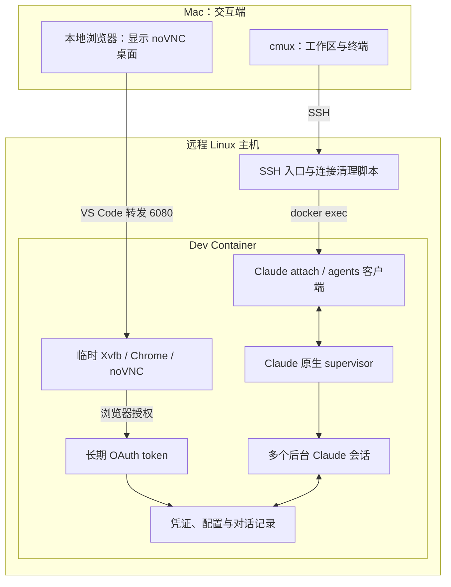
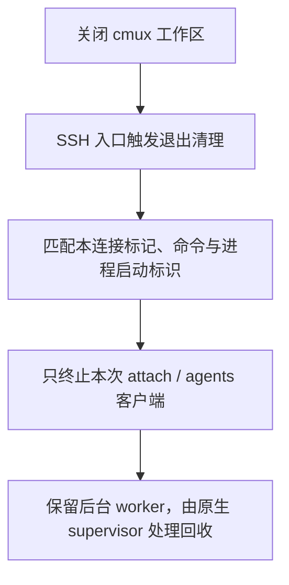

# 用 cmux 管理远程 Dev Container 中的 Claude Code：登录、后台会话与恢复


我的日常开发环境在远程 Linux 主机的 Dev Container 中。代码、依赖、测试服务和命令行工具都在容器里，Mac 负责编辑和交互。Claude Code 也应运行在同一个环境中，直接使用真实的项目文件与工具链。

落地时需要分别解决两件事：一是让浏览器授权和后续模型请求都从远程环境发起；二是让多个 Claude 会话便于创建、切换和恢复，同时能够释放不再工作的进程。

本文采用的组合是：**容器内 Chrome 完成授权，`claude setup-token` 生成长期凭证；容器内的 Claude 原生后台机制管理会话，Mac 上的 cmux 提供终端和工作区入口。**

实现过程中，我遇到了关闭工作区后进程仍然存活、连接端阻止回收、随机名称覆盖任务标题等问题。下面按最终方案说明配置和验证方法。

## 运行结构与适用范围

认证只在初始化或更换凭证时使用临时远程桌面。日常开发通过 SSH 连接，不依赖浏览器桌面持续运行。



浏览器授权请求由容器里的 Chrome 发出，Claude 的模型请求由容器里的 Claude 进程发出。本地浏览器承载的是远程桌面的显示与输入，cmux 承载的是远程终端交互。

这统一了请求的发起环境。公网出口是否固定，仍取决于远程主机的 NAT、代理、VPN 和网络配置；这套结构本身不提供固定公网 IP，也不能据此推导服务端的风控结论。

本文记录的验证环境是 **2026 年 10 月 27 日的 cmux 0.65.2 和 Claude Code 2.1.311**。后台会话的 Agent View 仍处于 research preview，升级后应重新核对命令、快捷键和回收行为。示例统一使用以下占位名称：

| 项目 | 示例值 |
| --- | --- |
| 远程宿主机 SSH alias | `project-host` |
| Claude 专用 SSH alias | `project-claude` |
| 容器名称 | `project-a-devcontainer` |
| 容器用户 | `node` |
| 项目目录 | `/workspaces/project-a` |

## 在容器内完成浏览器授权

### 临时浏览器桌面的职责

容器里通常没有可见桌面，因此我使用 Xvfb 提供虚拟显示，Chrome 打开授权页面，x11vnc 与 noVNC 提供远程访问。Mac 通过 VS Code 转发容器的 `6080` 端口，再用本地浏览器查看桌面。

各组件的职责如下：

| 组件 | 职责 |
| --- | --- |
| Xvfb | 提供 Chrome 所需的显示环境，例如 `DISPLAY=:99` |
| Chrome | 在容器中访问 Claude 登录和授权页面 |
| x11vnc | 将虚拟显示提供为 VNC 桌面 |
| noVNC / websockify | 让浏览器通过 WebSocket 连接 VNC 桌面 |
| VS Code 端口转发 | 将容器的 `6080` 映射为本地访问入口 |

镜像可以预装这些组件，具体启动脚本取决于镜像里的包路径和浏览器 sandbox 配置。VNC、noVNC 应限制在受控的本地或转发链路内，避免将登录桌面直接暴露到公网。[noVNC 官方说明](https://novnc.com/info.html)介绍了浏览器客户端、VNC 服务端和 WebSocket 代理之间的关系。

桌面就绪后，在容器终端执行：

```bash
DISPLAY=:99 claude setup-token
```

如果 CLI 没有自动打开浏览器，就把它打印的授权 URL 粘贴到 **noVNC 桌面中的 Chrome**。完成登录和授权后，按 CLI 提示完成回调或粘贴授权码。不要把授权链接另开在 Mac 的 Chrome 中，否则这次浏览器授权仍会从 Mac 发起。

`claude setup-token` 会将 token 打印到终端，**不会替你保存到文件**。根据[官方认证文档](https://code.claude.com/docs/en/authentication#generate-a-long-lived-token)，它生成的是一年有效的订阅 OAuth token，提前撤销会使其失效。它可用于模型请求，本地配置的 MCP 仍可使用，但不能建立官方 Remote Control 会话或获取 claude.ai connectors。

因此，本方案通过 SSH 和原生后台会话实现远程使用，不依赖官方 Remote Control。

### 保存凭证并让新终端自动加载

我的容器将 token 放在以下位置：

```text
/home/node/.claude/setup-token
/home/node/.claude/setup-token.env
```

在容器的 Bash 中保存 token。下面的输入不会回显，也避免把 token 直接写进命令历史：

```bash
set +x
umask 077
mkdir -p "$HOME/.claude"

IFS= read -r -s -p '粘贴 setup-token 生成的 token：' claude_setup_token
printf '\n'
printf '%s\n' "$claude_setup_token" > "$HOME/.claude/setup-token"
unset claude_setup_token
chmod 600 "$HOME/.claude/setup-token"

cat > "$HOME/.claude/setup-token.env" <<'EOF'
if [ -r "$HOME/.claude/setup-token" ]; then
    export CLAUDE_CODE_OAUTH_TOKEN="$(cat "$HOME/.claude/setup-token")"
fi
EOF
chmod 600 "$HOME/.claude/setup-token.env"
```

然后在容器的 `.bashrc` 和 `.zshrc` 中各加入一次：

```bash
if [ -r "$HOME/.claude/setup-token.env" ]; then
    . "$HOME/.claude/setup-token.env"
fi
```

启动入口使用 `bash -lic`，通过容器的交互式登录 Shell 加载凭证。Bash 登录时读取的 `.bash_profile` 或 `.profile` 需要引入 `.bashrc`，或直接引入同一个环境文件；不能仅凭 `.bashrc` 中有配置就推断所有入口都能加载。已有的 `.bashrc` 如果会在非交互模式提前返回，也应核对实际启动方式。

新开一个容器终端，检查变量是否存在及认证来源：

```bash
bash -lic 'test -n "$CLAUDE_CODE_OAUTH_TOKEN" && echo "OAuth token 已加载"'
bash -lic 'claude auth status'
```

本次检查中，两个文件权限均为 `600`，Bash 和 Zsh 都会加载环境文件，`claude auth status` 返回的认证方式是 `oauth_token`。验证无需输出 token 内容。

多个会话使用同一份凭证，无需分别登录。也应检查环境中是否遗留其他认证来源，例如优先级更高的 API key 或代理认证变量，避免实际使用的认证与预期不同。

完成授权和新终端验证后，就可以停止这次登录使用的 Chrome、Xvfb、VNC 和 noVNC 进程，并关闭 `6080` 转发。我的运行环境中，临时桌面已经停止，`6080` 不再监听，日常 Claude 会话继续使用保存的 token。

### 容器重建时保留状态

容器可写层不应承担长期保存凭证和历史的职责。建议在 Dev Container 配置中持久化 Claude 配置目录：

```json
{
  "mounts": [
    "source=claude-code-config,target=/home/node/.claude,type=volume"
  ],
  "containerEnv": {
    "CLAUDE_CONFIG_DIR": "/home/node/.claude"
  }
}
```

将它合并到已有的 `devcontainer.json`，并确认目录属主与容器用户一致。给已有目录挂载一个空卷会遮蔽原文件，迁移现有 token 和历史后再重建。

`CLAUDE_CONFIG_DIR` 配合持久卷，也用于保留用户配置文件所在位置；Shell 中的加载语句则应写入镜像或初始化配置。具体持久化范围可对照[官方 Dev Container 文档](https://code.claude.com/docs/en/devcontainer#persist-authentication-and-settings-across-rebuilds)检查。

## 用原生后台会话承载任务

直接运行下面这类命令，可以得到可交互的远程 Claude：

```bash
ssh -t project-host \
  'docker exec -it -u node -w /workspaces/project-a project-a-devcontainer bash -lic claude'
```

但这还不足以定义任务生命周期。实际测试中，关闭 cmux 工作区后，远程的普通 Claude 进程仍然存活。SSH 连接、Docker exec 客户端和容器内进程跨越了几层边界，不能用窗口是否消失来判断远端是否退出。

最终方案使用 Claude 自带的后台机制：

```bash
# 在容器里创建后台会话，获得短 ID
claude --bg --dangerously-skip-permissions

# 接入这个会话，得到完整的实时交互终端
claude attach <id>

# 查看原生会话列表
claude agents --dangerously-skip-permissions
```

这里需要区分三个对象：

| 对象 | 生命周期与职责 |
| --- | --- |
| cmux 工作区 | Mac 上的终端容器，负责显示、输入与切换 |
| `attach` / `agents` 连接端 | 容器内的交互客户端，属于本次 SSH 连接 |
| 后台 Claude worker | 原生 supervisor 管理的任务进程，独立于某个工作区 |

关闭工作区时，应让连接端退出；后台任务是否继续运行，由 Claude 原生机制及会话状态决定。对话记录保存在远程磁盘中，进程回收后仍可恢复。[Agent View 文档](https://code.claude.com/docs/en/agent-view)描述了这些原生命令和 supervisor 的职责。

`--dangerously-skip-permissions` 对应完全访问模式，它跳过 Claude 的权限确认，不会提升 Linux 用户本身的权限。该模式只适用于可信、边界明确的开发环境；容器内可读的凭证和挂载目录也处于 Agent 的访问范围内。

在交给启动脚本之前，应先在容器的项目目录中交互式运行一次 Claude，完成该版本要求的项目信任、首次初始化和权限提示，确认认证与普通交互可用。脚本里的后台启动无法替人完成这些对话，未完成初始化时可能直接报错退出。

## SSH 入口还需要清理连接端

把 `claude` 换成 `claude attach` 后，还有一个容易忽略的问题：**如果断开 SSH 后，容器里的 attach 客户端没有退出，后台会话就可能仍被认为有人连接，进而无法进入预期的回收路径。**

因此，我在宿主机增加了一个小的 SSH 入口脚本。它只做四件事：

1. 找到目标容器，必要时同步容器内辅助脚本；
2. 新建后台会话，或打开会话列表、恢复指定 ID；
3. 为本次连接端设置唯一标记；
4. SSH 入口收到 `HUP`、`TERM` 或正常退出时，只清理携带该标记的连接端。



清理前会同时检查连接标记、完整客户端参数和进程启动标识，避免把 PID 重用后的其他进程当成目标。不能用 `pkill claude`：后台 worker、其他任务和连接端都可能具有同样的进程名。

这部分是连接结束时的清理，不是定时杀进程的守护程序，也不会根据 CPU 占用低或长时间没有终端输出来终止任务。

### 安装示例脚本

这里提供从实测实现整理出的通用版本：

- [宿主机 SSH 入口：remote-claude](/downloads/remote-claude-cmux/remote-claude)
- [容器内辅助脚本：remote-claude-session.py](/downloads/remote-claude-cmux/remote-claude-session.py)

下载后先检查脚本顶部的容器名称、工作目录，以及容器用户和 Claude 可执行文件路径。示例使用 `node` 和原生安装器的 `~/.local/bin/claude`。

在 Mac 上将两个文件放到 Linux 宿主机：

```bash
ssh project-host 'mkdir -p ~/.local/bin ~/.local/libexec'
scp remote-claude project-host:.local/bin/remote-claude
scp remote-claude-session.py project-host:.local/libexec/remote-claude-session.py
ssh project-host 'chmod 700 ~/.local/bin/remote-claude ~/.local/libexec/remote-claude-session.py'
```

宿主机保留辅助脚本的副本。每次进入时，入口会检查容器内的副本并在缺失或不一致时同步，因此容器重建后不会仅仅因为辅助脚本丢失而失去入口。Claude 的安装、Shell 配置和凭证持久化仍需要由容器本身保证。

宿主机入口支持 `new`、`list`、`resume <id>` 和只读的 `status`。关闭连接后的清理结果记录在宿主机的 `~/.local/state/cmux-claude/last-cleanup.json`，便于核对究竟终止了哪个客户端。

### 配置 SSH alias

在 Mac 的 `~/.ssh/config` 中保留一个普通宿主机入口，再增加 Claude 专用入口：

```sshconfig
Host project-host
    HostName dev.example.com
    User dev

Host project-claude
    HostName dev.example.com
    User dev
    RequestTTY yes
    RemoteCommand /home/dev/.local/bin/remote-claude new
```

已有的密钥、跳板机等配置应沿用原连接设置。这里使用稳定容器名，避免将一次创建得到的容器 ID 写进长期配置。

此后，`ssh -t project-claude` 就会创建并接入一个新的远程后台会话。入口执行 `docker exec` 时使用容器用户，并通过 `bash -lic` 加载容器内的凭证。

## 将两个入口放进 cmux

在 Mac 的 `~/.config/cmux/cmux.json` 中合并以下配置，保留其他设置：

```json
{
  "newWorkspaceCommand": "新建远程 Claude",
  "commands": [
    {
      "name": "新建远程 Claude",
      "description": "新建远程后台 Claude 完全访问会话",
      "restart": "new",
      "workspace": {
        "layout": {
          "pane": {
            "surfaces": [
              {
                "type": "terminal",
                "command": "exec ssh -t project-claude",
                "focus": true
              }
            ]
          }
        },
        "setup": "/Applications/cmux.app/Contents/Resources/bin/cmux workspace-action --action clear-name --workspace \"$CMUX_WORKSPACE_ID\""
      }
    },
    {
      "name": "远程 Claude 会话",
      "description": "查看和恢复远程后台 Claude 会话",
      "restart": "new",
      "workspace": {
        "name": "远程 Claude 会话",
        "layout": {
          "pane": {
            "surfaces": [
              {
                "type": "terminal",
                "command": "exec ssh -t -o \"RemoteCommand=/home/dev/.local/bin/remote-claude list\" project-claude",
                "focus": true
              }
            ]
          }
        }
      }
    }
  ]
}
```

第一个入口创建独立会话，`newWorkspaceCommand` 让 `⌘N` 使用它。第二个入口覆盖 SSH 的 `RemoteCommand`，直接打开容器里的原生 `claude agents` 列表，不再创建一个新任务。

普通会话工作区不设置固定名称，并在初始化时清除 cmux 的自定义名称，让 Claude 发出的终端标题可以同步到左侧导航栏。管理工作区则固定为“远程 Claude 会话”，便于辨认。

保存后执行配置检查，再按 `⌘⇧,` 重载：

```bash
/Applications/cmux.app/Contents/Resources/bin/cmux config doctor --scope global
```

配置文件位置、合并规则和重载方式见 [cmux 配置文档](https://cmux.com/docs/configuration#cmux-json)。本方案以**工作区**作为多会话切换单位；`⌘T` 和 `⌘D` 的标签、分屏行为不应被当成同样的新建会话入口。

## 日常使用与标题管理

| 操作 | 入口 |
| --- | --- |
| 新建独立 Claude 会话 | `⌘N`，或命令面板中的“新建远程 Claude” |
| 查看后台会话 | `⌘⇧P` → 搜索“远程 Claude 会话” → 回车 |
| 在列表中查找 | `Ctrl+F`，或输入 `n:关键词` |
| 进入选中的会话 | 回车 |
| 从会话返回列表 | 输入框为空时按 `←` |
| 设置便于查找的会话名 | `/rename 任务名称` |
| 让 Claude 根据当前对话命名 | 不带参数的 `/rename` |

“找回”包含两种情况：worker 仍在时，客户端直接接入同一个运行中的会话；worker 已回收时，Claude 从保存的对话启动新进程，再接入终端。恢复的基础是磁盘记录，已经退出的进程内存不会被原样保留。

### 不要把随机标识当作任务名称

我最初给每个新会话传入 `--name "ECAP 时间 随机后缀"`，目的是方便区分。这样会把占位文本变成显式会话名，终端优先显示它，结果左侧出现了一串没有任务含义的名称。

最终入口去掉了创建时的 `--name`。新终端先显示“远程 Claude · 新会话”，用户提交任务后，Claude 生成主题标题。实测中，一条关于登录页深色模式的问题生成了“登录页深色模式验证”。

这里还要区分**终端主题标题**和**可持久查找的会话名**。在本次版本中，未显式命名的后台记录仍可能在 Agent View 中以短 ID 显示；自动主题标题不能被当成列表名称已经同步的证明。重要任务可以执行一次不带参数的 `/rename`，让 Claude 从对话生成并保存会话名，或手动设置一个明确名称。

此外，cmux 自定义工作区名、自定义标签名也可能覆盖终端标题。排查时应分别检查这几层。Claude 的命名规则可参考[会话管理文档](https://code.claude.com/docs/en/sessions#name-your-sessions)和 [`/rename` 命令说明](https://code.claude.com/docs/en/commands)。

## 关闭、回收与恢复如何验证

原生 supervisor 会根据任务和连接状态决定是否保留进程。官方描述的典型回收场景是：会话已完成或等待下一条消息，且约一小时无人连接；正在工作、等权限对话、有人连接或被固定的会话会受到保护。详见[supervisor 生命周期说明](https://code.claude.com/docs/en/agent-view#the-supervisor-process)。

这不能简化为“没有输出一小时就杀掉”。工具可能正在执行，Agent 可能等待审批；刚创建、还没发过首条消息的空会话，也不应套用已完成会话的回收结论。实际行为要结合 CLI 版本、会话状态和连接情况判断。

我的验证过程分为两轮：先验证普通交互，再保留一个完成任务且已断开的样本，等待回收后重新检查。

| 验证项 | 观察结果 |
| --- | --- |
| 实时输出 | 生成至第 36 行时已能看到输出继续增长，最终收到完整 70 行 |
| 交互与历史 | 输入、详细历史展开和翻页正常 |
| 关闭工作区 | 本次 attach 客户端退出，后台 worker 保留，另一个工作区不受影响 |
| 断开后继续对话 | 接回原会话，准确回答之前保存的测试标记 |
| 无连接空闲样本 | 10:08 断开，11:31 复查，原 worker 已退出，会话记录和历史仍在 |
| 回收后恢复 | 出现 `Waking session`，新进程接回同一会话，并再次准确回答测试标记 |
| 完全访问模式 | 启动参数和界面状态标识保持一致 |

没有记录到样本的精确退出时刻，因此这次测试验证的是“空闲后释放进程，保留对话，能够唤醒继续”的完整过程，不能据此声称恰好第 60 分钟退出。也没有用人工停止样本的结果来代替自然回收。

定位问题时可以使用只读状态接口：

```bash
# 容器终端
claude agents --json --all

# Linux 宿主机上的入口
~/.local/bin/remote-claude status
```

运行中的记录通常带有 `pid`；已释放进程的记录仍可能保留在列表中，但不再带运行 PID。判断回收时，还应检查原进程是否存在，以及记录和 transcript 是否保留，不能只看列表中的 `done` 或 `idle` 文本。

## 运维时保留的边界

**凭证更换与环境更新。** token 轮换后，应在新终端确认环境变量和认证来源。已经运行的进程不会因为磁盘文件变化就自动更新自身环境，需要结合任务状态验证新建和恢复路径。不要为了更换某个会话的凭证而批量终止所有 Claude 进程。

**会话隔离与代码隔离。** 多个 Claude 会话分别拥有对话上下文，不代表它们天然拥有独立 Git 工作区。并行修改同一仓库时，应核对实际工作目录与原生 worktree 设置；需要独立开发时，为任务分配独立工作树，并避免测试端口和生成文件相互覆盖。

**旧会话迁移。** 新入口只改变后续的启动方式。旧模式中的普通交互进程不会自动转换为这里的后台记录，也不会因为修改 cmux 配置而自动退出。迁移或结束它们时，需要逐个确认会话与任务。

**停止和删除。** 关闭终端、停止后台任务、删除会话记录是不同操作。需要明确停止某个任务时，使用针对 ID 的 `claude stop <id>`；删除原生会话前还应检查它关联的工作树和未提交改动，按当前版本的确认提示操作。

**升级验收。** 保留一组小而明确的检查：新终端能否使用预期凭证；`⌘N` 是否创建后台会话；关闭后连接端是否消失；列表能否恢复原对话；自动标题是否仍能到达左侧栏。涉及进程回收的升级，则另留无连接样本观察，避免以界面变化代替远程进程证据。

