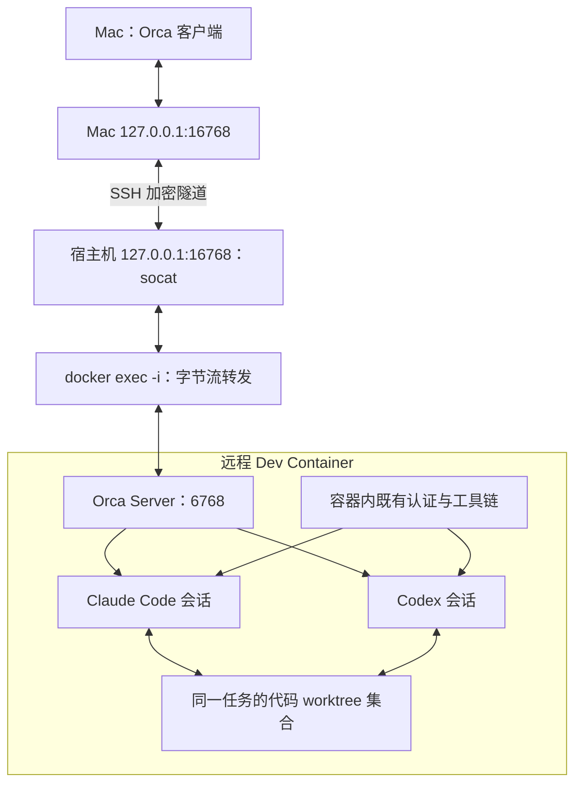
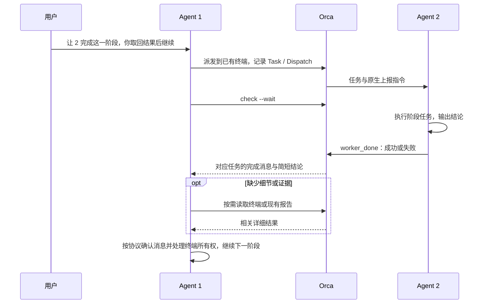

# 基于 Orca 的远程多 Agent 协作开发


我的开发环境在远程 Linux 主机的 Dev Container 中。代码、依赖、测试服务以及 Claude Code、Codex 都已经在容器里，本地 Mac 负责交互。

前一篇[用 cmux 管理远程 Claude Code](/remote-claude-cmux/)解决了登录、后台会话与恢复。接下来的需求是：同一个任务中，让 Claude Code 和 Codex 承担不同阶段的工作，并且能够读取彼此的执行结果。

分工由我在对话里决定。有时 Claude 先分析，Codex 实施；有时 Codex 做完一轮修改，请 Claude 评审，再由 Codex 继续修复。两个会话都需要可见，也需要共享当前代码状态。

最终采用的结构是：**Mac 运行 Orca 客户端，容器内运行 Orca Server；一个任务使用一组代码 worktree，每个涉及的仓库各一个，Claude Code 和 Codex 共享这些目录，并保留独立会话。普通交接直接交付任务；明确要求等待结果后继续时，才使用原生任务与完成协议。**

本文记录 **2026 年 10 月 28 日**的搭建与验证，以及 **10 月 29 日**对交接流程、跨仓边界和部署脚本的简化。Orca 客户端及 Linux 安装包均为 **v1.4.243**，参与验证的 Claude Code 为 **2.1.312**，Codex 为 **0.165.0**。Remote Orca Servers 仍处于 beta，升级后需要重新核对连接、CLI 和会话行为。

## 先确定执行环境和任务边界

这套方案有三个基本约定。

第一，Orca 的服务端和两个 agent 都运行在容器内。文件操作、Shell、Git、测试和模型调用使用同一套远程环境。Mac 上已有的登录不会自动成为容器内的登录。

第二，独立任务之间使用不同的代码 worktree。同一任务只涉及一个仓库时，两个 agent 共享一个 worktree；涉及多个仓库时，各仓库各有一个任务 worktree，两个 agent 共享整组目录。双方能直接看到彼此尚未提交的修改，因此也需要明确写入责任：同一仓库通常一个修改、另一个只读，阶段结束后再交接。

第三，agent 的角色随指令变化。用户让哪一方等待结果，哪一方就临时负责这一轮的派发与等待。这里不预设固定的协调者、实施者或评审者。

需要区分以下概念：

| 概念 | 在这套工作流中的含义 |
| --- | --- |
| Project | Orca 中登记的代码项目；多个任务共用这个项目 |
| Git worktree | 独立的分支和工作目录，用于隔离不同任务的代码修改 |
| Workspace | Orca 组织目录、终端、编辑器与会话的单位；可以作为任务入口，代码工作目录还可能包括其他仓库的 worktree |
| Agent session | 一个 Claude Code 或 Codex 会话；两个会话有各自的上下文 |
| Run / Task / Dispatch | 需要等待结果的原生协作中，一次协调范围、一项工作，以及该工作的某次执行；普通交接不创建这些记录 |

Orca 也支持目录型工作区，所以 workspace 与 Git worktree 并非普遍同义。本文采用的是它的 [Git worktree 工作流](https://www.onorca.dev/docs/model/worktrees)。

## 运行结构：Mac 连接容器中的 Orca Server

我使用 [Remote Orca Server](https://www.onorca.dev/docs/remote-servers)承载项目和终端状态，再通过 SSH 隧道连接。这里增加了一层 Docker 转发，服务最终运行在开发容器里。



连接路径是：

```text
Mac Orca
  → Mac 回环端口
  → SSH 隧道
  → 宿主机回环端口
  → docker exec -i + 容器内 socat
  → 容器内 Orca Server
```

本环境使用 rootless Docker，宿主机不能按普通 bridge 网络的假设直接访问容器 IP。因此我没有将隧道目标写成一个动态容器地址，而是经由 `docker exec -i` 转发字节流。容器无需额外安装 sshd，也没有为 Orca 发布 Docker 公网端口。

下文统一使用占位名称：

| 配置 | 示例值 |
| --- | --- |
| 宿主机 SSH alias | `project-host` |
| 宿主机登录用户 | `dev` |
| 稳定的容器名称 | `project-a-devcontainer` |
| 容器用户 | `node` |
| 项目目录 | `/workspaces/project-a` |
| 容器服务端口 | `6768` |
| 隧道端口 | `16768` |

## 容器内安装与认证

### 安装与客户端对应的 Linux 版本

Mac 使用 [Orca 官方安装包](https://www.onorca.dev/docs/install)。容器内使用同一版本的 Linux AppImage，解包后调用随包提供的 CLI，避免依赖容器内的 FUSE 挂载。

下面是在容器内以 `node` 用户执行的首次安装示例，适用于尚未存在这些安装链接的情况：

```bash
orca_version=v1.4.243
orca_root="$HOME/.config/orca-runtime"

case "$(uname -m)" in
  x86_64) orca_asset=orca-linux.AppImage ;;
  aarch64|arm64) orca_asset=orca-linux-arm64.AppImage ;;
  *) printf '请核对当前架构的安装包\n' >&2; exit 1 ;;
esac

mkdir -p "$orca_root/releases/$orca_version" "$orca_root/bin" "$HOME/.local/bin"
cd "$orca_root/releases/$orca_version"
curl -fL -o orca.AppImage \
  "https://github.com/stablyai/orca/releases/download/$orca_version/$orca_asset"
chmod u+x orca.AppImage
./orca.AppImage --appimage-extract >/dev/null

ln -s "$orca_root/releases/$orca_version/squashfs-root" "$orca_root/current"
ln -s "$orca_root/current/resources/bin/orca-ide" "$orca_root/bin/orca-ide"
ln -s "$orca_root/bin/orca-ide" "$HOME/.local/bin/orca-ide"
```

Linux 安装入口使用 `orca-ide`，避免与 GNOME 的 Orca 屏幕阅读器命令冲突。Orca 自己管理的终端中还会提供 `orca` 命令。脚本应先确认调用的是当前 Orca 的 CLI。

我的目录结构如下：

```text
/home/node/.config/
├── orca/                         # Server profile 与状态
└── orca-runtime/
    ├── releases/v1.4.243/        # 对应版本的解包目录
    ├── current                  # 当前版本链接
    ├── bin/                     # CLI、服务入口、停止辅助脚本
    └── skills/orca-peer-workflow/
```

项目目录位于持久化 bind mount，`.config` 与 `.claude` 使用既有持久化卷。Codex 的认证和历史目录也需要核对实际挂载或链接目标；仅保存 Orca 的 profile，不能代替保存 provider 的状态。容器重建前，应分别检查这些目录，避免新挂载遮住旧文件。

### 沿用容器内的认证

Claude 沿用上一篇文章中的登录方式：在容器内浏览器完成授权，执行 `claude setup-token`，将凭证保存在容器内，并通过 `setup-token.env` 加载 `CLAUDE_CODE_OAUTH_TOKEN`。

服务进程通常不会自动执行交互式 Shell 的 `.bashrc`。因此，Orca 的服务入口会显式加载环境文件，让它随后启动的 Claude 子进程继承认证。

Codex 则复用容器内既有登录。本次检查执行 `codex login status`，返回 `Logged in using ChatGPT`。我没有将 Mac 的认证文件复制进容器，也没有为每个任务重新登录。

可以在容器内检查认证状态，而不输出凭证内容：

```bash
. "$HOME/.claude/setup-token.env"
claude auth status
codex login status
```

本方案启动的 agent 由容器进程发起模型请求。本地 Mac 承载界面和控制连接。实际公网出口仍由远程主机的 NAT、代理和网络配置决定；“进程在远程执行”本身不等于获得固定公网 IP。

## 启动服务并打通 SSH 链路

### 服务入口要显式设置环境

核心启动配置是：

```bash
export ORCA_USER_DATA_PATH=/home/node/.config/orca
export PATH=/home/node/.config/orca-runtime/bin:/home/node/.local/bin:$PATH
. /home/node/.claude/setup-token.env

exec /home/node/.config/orca-runtime/bin/orca-ide serve \
  --port 6768 \
  --pairing-address ws://127.0.0.1:16768 \
  --json
```

`--pairing-address` 是客户端应连接的地址，不是服务监听地址。这里的回环地址指向 Mac 上的 SSH 转发入口；离开这条隧道，它不能用于另一台机器直接连接。SSH 已承担链路加密，因此这里使用 `ws://`，没有将一个明文 WebSocket 服务错误标记为 `wss://`。

完整运行入口还负责原子写入自身 PID 及进程启动时间、恢复自定义 skill 的链接。官方 skill 在安装或维护时初始化，服务启动不再执行安装命令，避免把启动可用性与 skill 安装耦合。我将正在使用的入口和停止辅助脚本整理为下载文件：

- [容器内服务入口：serve-project](/downloads/remote-orca-collaboration/serve-project)
- [容器内停止辅助脚本：stop-project.py](/downloads/remote-orca-collaboration/stop-project.py)

将它们安装到容器内 `/home/node/.config/orca-runtime/bin/`，赋予入口执行权限，并提前放置后文的协作 skill。这两个脚本按本文的 `node` 用户及目录布局编写。

### 用宿主机的用户服务托管

宿主机的 `~/.config/systemd/user/orca-project.service`：

```ini
[Unit]
Description=Orca Server in project devcontainer
After=default.target

[Service]
Type=simple
ExecStart=/usr/bin/docker exec -u node project-a-devcontainer /home/node/.config/orca-runtime/bin/serve-project
ExecStop=/usr/bin/docker exec -u node project-a-devcontainer python3 /home/node/.config/orca-runtime/bin/stop-project.py
Restart=always
RestartSec=15
TimeoutStopSec=30
StandardOutput=append:/home/dev/.local/state/orca-project/server.log
StandardError=append:/home/dev/.local/state/orca-project/server.log

[Install]
WantedBy=default.target
```

启动前创建日志目录和文件，并设置权限；服务启动输出可能包含配对链接：

```bash
install -d -m 700 "$HOME/.local/state/orca-project"
touch "$HOME/.local/state/orca-project/server.log"
chmod 600 "$HOME/.local/state/orca-project/server.log"
systemctl --user daemon-reload
systemctl --user enable --now orca-project.service
```

如果需要退出 SSH 后继续托管，应检查 `loginctl show-user "$USER" -p Linger`；未开启时，按主机的权限策略配置 `loginctl enable-linger`。

这里的 `ExecStop` 有实际作用：**结束宿主机上的 `docker exec` 客户端，不能据此推断容器里的进程已经退出。** 停止辅助脚本核对 PID、进程启动时间和命令行，只向身份匹配的 CLI 发送终止信号。身份无法核实或等待退出超时会返回非零状态，不能把“发过信号”报告为“已经停止”。Orca 管理的终端会话仍需遵循它自己的生命周期，不能用批量 `pkill claude` 代替清理。

### rootless Docker 的回环转发

宿主机和容器都需要 `socat`。宿主机的 `/home/dev/.local/state/orca-project/relay.sh`：

```bash
#!/usr/bin/env bash
set -euo pipefail
exec /usr/bin/docker exec -i -u node project-a-devcontainer \
  /usr/bin/socat STDIO TCP:127.0.0.1:6768
```

同目录下的 `proxy.sh`：

```bash
#!/usr/bin/env bash
set -euo pipefail
exec /usr/bin/socat \
  TCP4-LISTEN:16768,bind=127.0.0.1,reuseaddr,fork \
  EXEC:/home/dev/.local/state/orca-project/relay.sh,pipes
```

把带有 `TCP:...` 的容器转发命令放入独立脚本，可以避免将它直接嵌进 `socat EXEC:` 地址时产生冒号解析问题。转发只监听宿主机的 `127.0.0.1:16768`。

第二个用户服务 `~/.config/systemd/user/orca-project-proxy.service` 托管这个入口：

```ini
[Unit]
Description=Private loopback transport for Orca
After=orca-project.service

[Service]
Type=simple
ExecStart=/home/dev/.local/state/orca-project/proxy.sh
Restart=always
RestartSec=10
StandardOutput=append:/home/dev/.local/state/orca-project/proxy.log
StandardError=append:/home/dev/.local/state/orca-project/proxy.log

[Install]
WantedBy=default.target
```

在宿主机设置脚本和日志权限，再启用服务：

```bash
chmod 700 "$HOME/.local/state/orca-project/relay.sh" \
  "$HOME/.local/state/orca-project/proxy.sh"
touch "$HOME/.local/state/orca-project/proxy.log"
chmod 600 "$HOME/.local/state/orca-project/proxy.log"
systemctl --user daemon-reload
systemctl --user enable --now orca-project-proxy.service
```

Mac 上建立隧道：

```bash
ssh -N -T \
  -o BatchMode=yes \
  -o RemoteCommand=none \
  -o RequestTTY=no \
  -o ControlPath=none \
  -o ExitOnForwardFailure=yes \
  -o ServerAliveInterval=30 \
  -o ServerAliveCountMax=3 \
  -L 127.0.0.1:16768:127.0.0.1:16768 \
  project-host
```

`RemoteCommand=none` 和 `RequestTTY=no` 用于覆盖 SSH alias 中可能存在的“自动进入 Claude”配置，避免隧道连接执行交互式启动命令。我的 Mac 使用 LaunchAgent 托管这条隧道，配置 `RunAtLoad`、`KeepAlive` 和重启间隔；`ProgramArguments` 直接指向 `/usr/bin/ssh` 及其参数，不再经由 Python 包装脚本。每次打开任务无需重新手输 SSH。

### 用同一份配置源维护部署

手工配置用于说明各层职责。日常维护则统一从一份配置源生成服务、转发脚本和 LaunchAgent，避免早期安装脚本把已经修正的地址、协议或入口覆盖回去。

可下载[配置维护包 orca-project-config.zip](/downloads/remote-orca-collaboration/orca-project-config.zip)。它包含 `install-project.py`、服务入口、停止脚本和完整协作 skill。先完成前文的 Orca 解包安装，确保宿主机与容器都有 `socat`；在 Mac 解压，按自己的环境修改安装脚本顶部的 `ALIAS` 与 `CONTAINER`，再从解压目录运行：

```bash
python3 install-project.py --check
python3 install-project.py --apply
python3 install-project.py --apply --reload-tunnel
```

`--check` 只读，有配置差异、服务未运行或隧道需要加载时返回退出码 2。`--apply` 先备份再同步，仅在服务未运行时启动，不重启活跃的远程服务；新增启动逻辑在下次正常启动时使用。`--reload-tunnel` 加载 Mac 隧道配置，可能让客户端短暂重连，容器中的 agent 继续运行。重复执行无差异的配置不会重写文件。

这个维护包不负责下载或升级 Orca，也不复制认证。示例仍使用 `node` 用户、`/home/node/.config/orca-runtime` 和前文端口；目录布局不同的环境需一起调整。没有为简化链路重建当前容器：它没有发布 Orca 端口，现有回环代理仍有实际作用。

### 在 Mac 中配对

服务启动后会生成配对信息。保持 SSH 隧道在线，在 Mac Orca 的 **Settings → Remote Orca Servers → Add Server** 中添加服务，使用该服务生成的配对链接。

配对链接包含访问能力，不能放入文章、仓库或截图。添加后确认连接状态为 Connected，并将新项目的默认 host 指向该远程环境，再登记容器内的项目目录。

这一步应验证远程终端中的 `pwd`、`whoami` 和 agent 路径，而不只是检查界面上出现了一个项目名称。服务端、代理、隧道是三个独立环节，排查时也应分别检查。

## 项目内按任务创建 worktree

我的项目只登记一次。在项目旁点击创建工作树的 `+`，为独立任务创建 worktree，并选择起始分支和第一个 agent。

打开该任务的工作区后，再使用顶部的“新标签页”菜单启动 Claude 或 Codex，或通过自然语言让当前 agent 在**当前 worktree** 中启动另一方。后者应使用 Orca 的 `agent launch`，而不是另开一个不受 Orca 管理的 SSH 终端。

```text
项目 project-a
├── 任务：修复登录状态
│   ├── Claude Code
│   └── Codex
└── 任务：调整查询缓存
    ├── Codex
    └── Claude Code
```

项目旁的 `+` 创建任务工作树；工作区内部的新标签页菜单增加会话。**给当前工作区增加一个标签页，不会为新任务建立文件隔离。** 原始 checkout 的“主要”标记也不表示它当前检出的一定是 Git `main` 分支。

我将新建 worktree 的位置配置在项目自己的持久化挂载中：

```text
/workspaces/project-a/.worktrees/project-a/<task-name>
```

这里将项目设置中的 `worktreeBasePath` 设为 `.worktrees`。本次搭建发现，Mac 客户端的通用工作目录设置没有替代 headless 服务端的项目配置。也不宜把默认工作树目录简单软链接到另一处：路径被规范化后，可能与 Orca 记录的工作区身份不一致。

这套流程保留了“先创建任务 worktree，再开始会话”的原生模型。“先开一个未绑定 worktree 的空白任务，再在对话中原地转换，并仍显示在同一项目下”的入口不在本文方案中。

### 一个任务修改多个仓库

Orca 中登记的项目决定创建工作树时默认针对哪个仓库。例如，登记 `project-a` 后，从它旁边的 `+` 创建的是该仓库的工作树；这个操作不会自动为另一个仓库创建 worktree。

我仍可以保留 `project-a` 的 Orca 工作区作为统一入口，通过对话让 agent 为参与修改的其他仓库准备本任务的 worktree，并明确目录映射：

| 仓库 | 本任务的代码 worktree | 分支示例 |
| --- | --- | --- |
| project-a | `/workspaces/project-a/.worktrees/project-a/fix-session` | `feat/fix-session` |
| engine | `/workspaces/engine/.worktrees/fix-session` | `feat/fix-session` |

两个 agent 复用这份映射，不因切换 agent 或进入下一阶段重新创建 worktree，也不要求为每个阶段登记新项目。Orca 的工作区身份用于定位终端；代码读写、Git 和测试则使用目标仓库的实际目录，例如 `git -C <engine-worktree> status`。不能把入口工作区的 `worktree current` 结果当成所有仓库的代码路径。

同一仓库默认仍只有一方写入；确需并行时，由用户明确划分不同仓库或其他互不重叠的修改范围。

当前 agent 的启动权限沿用 Orca 的全自动配置：Claude 使用 `--dangerously-skip-permissions`，Codex 使用 `--dangerously-bypass-approvals-and-sandbox`。它们仍受容器和 `node` 用户的系统权限限制。写入范围由任务指令约束，而不是把共享 worktree 当作两个进程之间的强隔离边界。

## 用一份协作 skill 统一规则

Orca 提供工作区、终端和协作协议；Claude 与 Codex 并不会因此自动共享模型上下文。需要让双方知道什么时候读取、什么时候派发，以及谁负责后续工作。

我保留官方 `orca-cli` 和 `orchestration`，另加一个短的 `orca-peer-workflow` skill，记录本环境的协作约定。入口先区分查看、直接交接和等待返回；只有明确需要等待时，才加载 `references/supervised.md`。它不复制整套 CLI 文档，而是按需通过运行中的 CLI 获取对应版本的指南；同一会话读过且版本未变的指南直接复用。

官方 skill 可以在容器中安装：

```bash
orca-ide skills install --skill orca-cli --skill orchestration --agent claude,codex
```

自定义 skill 的完整内容可下载：[orca-peer-workflow.zip](/downloads/remote-orca-collaboration/orca-peer-workflow.zip)。压缩包包含主文件和按需加载的参考文件，并保留完整 front matter，避免托管平台将它作为 Markdown 页面处理。解压后保留整个目录：

```text
/home/node/.config/orca-runtime/skills/orca-peer-workflow/
├── SKILL.md
└── references/supervised.md
```

并让双方的发现目录指向它：

```text
/home/node/.agents/skills/orca-peer-workflow  → 同一份 skill
/home/node/.claude/skills/orca-peer-workflow  → 同一份 skill
```

服务入口会检查并恢复这些链接，已有同名非预期文件时应先检查，避免覆盖。对于已打开、可能缓存旧规则的会话，我会明确要求它重新读取这份 `SKILL.md`。

本次实测还暴露了一个容易浪费时间的细节：agent 为了寻找 `orchestration/SKILL.md` 扫描了整个文件系统。实际上，官方 skill 使用很薄的发现入口，完整指南由当前 CLI 提供。最终规则直接要求：使用 `ORCA_CLI_COMMAND` 指向的 CLI 执行 `skills get orca-cli` 或 `skills get orchestration`，不全盘搜索文档。相关机制见 [Orca skills 说明](https://www.onorca.dev/docs/cli/skills)。

## 三种自然语言指令，对应三种行为

### 直接交接，默认走短路径

例如对 Codex 说：

> 把已有的性能验证结果交给 Claude，让它设计 Phase 2。

在我的协作规则里，这表示由 Claude 接手后续阶段，Codex 交付后停下。单独出现“Phase 2”或“下一阶段”，不表示原 agent 还要监督执行或再取回结果。这个默认约定与官方指南中[完整交接](https://github.com/stablyai/orca/blob/v1.4.243/skill-guides/orca-cli.md#full-handoffs)的职责边界一致。

已有目标会话和有效句柄时直接复用；目标状态不明确时先检查当前屏幕。交接消息只传必要的目标、修改权限、仓库目录映射、已有证据位置和待办，大段分析按需读取，不为了发送任务重新跑一遍调查和测试。

```text
orca terminal send \
  --terminal <目标终端句柄> \
  --text "根据现有验证报告设计 Phase 2；先只读，报告与代码目录见任务上下文" \
  --enter --json
```

发送回执表示已接受，不能据此宣称对方已开始工作或已经完成。需要确认开始执行时，再使用提交观察能力核对。普通交接不创建 Run、Task 或 Dispatch，原 agent 也不继续轮询；回执不明确时按原请求核查，避免重复发送。

### 查看已有结果

例如对 Claude 说：

> 看一下 Codex 刚才的分析，结合当前 diff 判断还有哪些问题。

Claude 应复用当前任务中 Codex 的会话信息，先读已有结论，按需要补充终端输出和实际代码。只有信息缺失或句柄失效时再查询。这里不向 Codex 派新任务，也不建立编排记录。

### 委派一个阶段，拿到结果后继续

例如对 Codex 说：

> 让 Claude 只读评审这一阶段的修改，你等待它完成，读取评审结论后继续修复。

这包含一个明确的返回关系：Codex 保留后续责任，Claude 只负责这轮评审。Codex 等待期间暂停修改，Claude 完成并待命后，再由 Codex 继续。

三种行为的区别在于后续责任归谁。说“交给 Claude”时，Claude 接手；说“你等 Claude 评审完再继续”时，原 agent 保留后续责任。明确这件事，比为所有协作套同一个完整流程更有效。

## 一次交接为什么花了五分钟

10 月 29 日，一条普通交接从用户提出要求到首次发送消息，准备了 **314.27 秒**；实际发送命令只用了 **1.62 秒**。发送前执行了 13 次 Shell 命令，原始工具输出约 17.8 万字符，包括整份 CLI 帮助、重复读取的协作指南和项目材料。最后使用的仍是普通 `terminal send`，没有建立监督任务。

这次记录说明，耗时主要发生在交接准备阶段，不能归因于消息传输慢。旧规则把“交给另一方”和“等另一方完成后继续”的路径混在了一起，还要求预读游标、收到完成消息后再读终端并核对代码，给简单交接引入了额外工作。

修订后的规则先决定交接方式，再按需获取信息：复用有效句柄和已有指南，发送摘要与证据位置，不为交接重做研究；只有明确需要等待时才加载编排协议。这是一次具体记录与对应修正，尚没有优化后的耗时对照，不能把它写成已经验证的加速比例。

## 发起方如何知道另一方已经完成

只有明确要求等待结果后继续的阶段，才使用 Orca 原生 `orchestration`。发起方为本轮绑定 Run，再将 Task 派给已有的目标终端；Dispatch 标识这次具体执行。这里的流程不用于普通交接。

下面是在 Orca 管理的终端中执行的命令形态。尖括号是运行时返回值的占位符；真实执行由 agent 读取当前指南完成：

```text
orca orchestration run-create --objective "评审当前阶段并取回结论" --json

orca orchestration worker-start \
  --spec "当前 worktree 只读评审；输出结论、验证结果和待办，然后按派发指令上报完成" \
  --worktree current \
  --terminal <目标终端句柄> \
  --json

orca orchestration check \
  --wait \
  --types "worker_done,escalation,question" \
  --timeout-ms 60000 \
  --json
```

`worker-start --terminal` 复用已经存在的会话。不能只传 `--agent` 然后假定它会找到先前的那个终端；在当前版本中，不显式指定终端通常会启动新的 worker。

接收方拿到的原生派发指令包含准确的身份和上报参数。完成阶段工作后，它先给出结论、验证结果和未解决问题，再发送一次 `worker_done`，明确标记 `succeeded` 或 `failed`，随后待命。它应按实际注入的指令上报，不能从旧记录拼一个 Task 或 Dispatch ID。

发起方正在 `check --wait` 中等待。消息返回后，先核对它是否属于预期 Task 和 Dispatch，并检查结果状态。**完成消息正文足以支持下一步时，直接使用其中的结论；只有缺少细节或证据时，才补读终端、报告或 diff。** 是否需要复核测试和代码，取决于本轮职责，不默认重做对方全部验证。

完成消息按协议确认，终端则根据所有权决定复用、保留或释放。用户已有会话继续保留；临时 worker 不应每次都永久 `retain`。



因此，“知道完成”依靠对应任务的完成协议，取多少详细结果则由下一步需要决定。终端暂时安静、显示 Done、消息已接受，都不能单独代替任务完成协议。超时只是检查点：核查本轮任务状态，不扫描无关历史 worker，也不直接宣告成功或重复派发。完整协议见 [v1.4.243 的 orchestration 指南](https://github.com/stablyai/orca/blob/v1.4.243/skill-guides/orchestration.md)。

## 按需获取详细结果

我的默认做法是：派发指令发送必要摘要、边界和来源终端句柄，大段结果由对方通过 `terminal read` 按需读取。代码与 diff 直接读取共享 worktree，不额外复制一份。

```text
orca terminal list --worktree current --json
orca terminal read --terminal <目标句柄> --json
orca terminal read --terminal <目标句柄> --cursor <输出流游标> --limit 1000 --json
orca terminal read --terminal <目标句柄> --screen --json
```

[CLI 的终端读取接口](https://www.onorca.dev/docs/cli/reference#terminals)区分输出流与当前屏幕：

| 读取方式 | 用途与限制 |
| --- | --- |
| 默认 `terminal read` | 读取输出流；TUI 重绘可能产生重复和碎片 |
| `--cursor` | 从输出流位置继续读取；需要检查实际返回来源和分页标记 |
| `--screen` | 读取当前渲染画面；没有可分页的历史，不能与 `--cursor` 混用 |

需要跟踪新增输出时，使用不带 `--screen` 的读取，只有返回 `source: stream` 时才保存输出流游标，再按需分页。不能把屏幕读取中的游标用于输出流，也不把“先读游标、再读输出流、再读屏幕”规定成每次交接的固定步骤。

**本次验证发现，当前远程环境中的输出流读取没有返回预期的新增内容。** 发起方最初还混用了屏幕游标。最后是通过 `terminal read --screen` 读到了目标终端上完整可见的短结论，并与完成消息一致。

因此，skill 保留了来源检查和屏幕回退。如果输出流历史丢失、当前屏幕也没有覆盖全部内容，agent 应明确说明缺失；一条完成摘要足以支撑某个决定，不代表已经读过全部分析。

本工作流不强制每次生成交接文件。已有日志和文档可以直接引用；如果具体任务要求保存完整报告，再按任务需要落文件。无论读取终端还是读取文件，进入接收方的内容都会占用它的上下文，需要控制相关性和读取范围。

## 一次真实的往返验证

为了验证阶段委派，我创建了一个独立测试 worktree，打开 Claude 与 Codex 两个终端，测试范围只允许生成随机值，不修改业务文件。

Claude 作为本轮发起方，复用已经存在的 Codex 终端，要求它运行 `python3` 生成一个 UUID，在终端输出结果，再按原生协议上报完成。Claude 事先不知道这个随机值，必须等待并读取对方结果后才能继续。

目标会话输出：

```text
PEER_RESULT=6ee69921-65ff-4924-94a1-40b86ee31219
```

发起方收到完成消息并读取目标终端后输出：

```text
CONTINUED=6ee69921-65ff-4924-94a1-40b86ee31219
```

除了对比文本，我还核对了原生状态：

| 验证项 | 观察结果 |
| --- | --- |
| 目标会话 | `worker-start --terminal` 复用既有 Codex，没有另开 worker |
| 完成消息 | 由 Codex 自己发送，Task / Dispatch 与本轮一致 |
| 执行状态 | Dispatch 为 `completed`，worker 为 `succeeded`、`settled` |
| 结果取回 | Claude 读到与 Codex 实际生成值相同的 UUID；本次依赖屏幕读取回退 |
| 会话保留 | 这次旧版测试执行了保留操作；当前规则按终端所有权与后续用途决定，不对临时 worker 一律保留 |
| 文件状态 | 测试 worktree 无修改，HEAD 未变化 |
| 清理 | 测试终端、worktree 和测试分支均已删除，原有两个开发会话保留；历史资源记录仍存在，见下文 |

这次验证覆盖了 **Claude → Codex → Claude** 的完成通知和短结果取回，支持本轮使用原生协议闭环。它没有证明反向协作、任意长度历史读取、网络异常恢复或服务重启后的全部行为都已经通过测试。角色互换沿用同一份规则，仍需在实际使用中核对。

10 月 29 日的配置修订通过了只读一致性检查、六项隔离的停止逻辑检查，以及 Mac 经 SSH 隧道调用远程 CLI 的检查。重载 Mac 隧道后，远程服务 PID、运行时 ID 和两个真实开发会话的句柄均未变化。启动脚本已更新，新增逻辑等待下次正常启动使用；这次没有为验证它重启正在工作的 Server。

### 进程退出与历史记录保留分开判断

后续检查发现，测试终端和进程虽然已退出，原生资源记录仍为 `external/retained`。再次执行 `worker-release` 也没有清掉这条历史元数据。**释放命令成功、元数据仍被保留、进程已经退出，是三个不同状态。** 不能把历史记录显示为保留，直接判断成后台还有一个 agent 在运行。

当前 v1.4.243 的 `orchestration reset` 只提供 `--all`、`--tasks`、`--messages` 范围，没有单 Run 选项。环境中已有真实任务记录，因此我保留了这条测试历史，没有为清掉它执行全局重置或直接修改数据库。日常等待只检查本轮 Task 和 Dispatch；不再使用的临时 worker 先核对释放回执，再清理测试工作区。

## 日常使用与收尾

现在每个独立任务先在项目中建立入口工作区，选择一个 agent 开始。跨仓任务再明确参与仓库的代码 worktree 映射。需要第二方时，在当前任务中增加会话，再用自然语言说明它本轮的职责和是否需要返回结果；换阶段不换一组代码目录。

一些日常指令可以写得很直接：

> 在当前 worktree 启动 Claude，只读分析这次失败的测试，先不要修改代码。

> 把现有验证报告交给 Claude，让它设计下一阶段方案。

> 让 Codex 实施刚才确定的方案，你等待它完成，然后读取结果并检查测试。

> 看一下 Claude 的结论，结合当前 diff 继续修复；保留现有未提交修改。

同一 worktree 中，等待结果的一方暂停写入；接收方完成并待命后，再交回写入责任。确实需要同时修改时，由用户明确划分互不重叠的范围。

Mac 断开连接时，容器中的服务和 agent 可以继续运行；直接关闭终端标签则属于进程和会话生命周期操作，不能当作“仅断开显示”。暂停、恢复、关闭和删除 worktree 应分别处理，删除工作区前先确认代码及提交状态。本次没有启用自动休眠，也没有增加按空闲时间杀进程的脚本。

任务完成后，我仍按各仓库正常的 Git 流程检查 diff、运行测试、提交和发起评审，再清理对应 worktree。Orca 负责组织任务环境和协作状态，具体开发决策与角色交接仍由对话中的指令决定。

